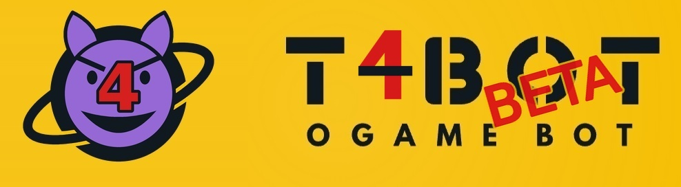

<p align="center"></p>

# tbot4.0-beta

A modified fork of the OGame bot **TBot** (C# / .NET 9) with the Go helper **ogamed**, in one repository.
Beta software: changes are made on a live account and not every combination is tested.

## What is different from the base version
- **Split config:** `instance_settings.json` can reference per-block files in `conf.d/` and credentials in `secrets/` (`Load`), converted with `tools/split-config.py`.
- **Config page in the web UI:** form view for the `Expeditions` block (more blocks can be enabled in `settings.json`), with a "Hide data" switch for screenshots.
- **Expeditions:** return time for sleep waves (`SleepWave.ReturnAt`), minimum primary ships, per-origin expedition limit with round-robin slot split, lifeform bonus panel.
- **AutoFarm:** alliance whitelist (`AutoFarm.AllianceWhitelist`) that excludes members from scans, spying and attacks.
- **AutoFarm, deuterium:** `AutoFarm.ReduceDeuterium` lets the attack fleet and the recyclers fly as slowly as sensible (never below 30 %, flight time limit kept). A low-deuterium guard (`DeuteriumGuard`, default 10M) pauses attacks on defended targets and switches the speed fleet off when a start celestial runs low; it can be bridged manually (`DeuteriumGuardOverride`). The AutoFarm page shows the deuterium stock, a warning, and profit after losses and fuel.
- **AutoFarm escorts:** absolute cap per ship type, editable for every type of the escort lists in the web UI.
- **GhostSleep:** optional expedition drain before sleep (`GhostSleep.ExpeditionDrain`, measured expedition duration), Defender check anchored on the last returning fleet (`GhostSleep.AnchorMode`). GhostSleep only reduces activity; it is not a real sleep and should not run every day.
- **Brain / transports:** transport chain, compact slot plan, `DeutToLeaveOnMoons`, home planet protection in the abandon checks.
- **Discord webhook** mirror for all notifications.
- **Packages:** `tools/build-windows.sh` and `tools/build-linux.sh` pack ready-to-use archives without any config, secrets or data.

## Documentation
| File | Content |
|---|---|
| [`config/REFERENCE.md`](config/REFERENCE.md) | Every config block and field, with quick start for a new account |
| [`config/README.md`](config/README.md) | Config template, split config (`conf.d/`, `secrets/`), Linux package |
| [`config/config.vorlage.json`](config/config.vorlage.json) | Anonymised config template (no credentials, no real coordinates) |
| [`NOTICE.md`](NOTICE.md) | Credits and third-party notices |

## Quick start
1. Download a package from [Releases](../../releases) or build it yourself (below).
2. Copy `config/config.vorlage.json` to `instance_settings.json` and fill in your account data (see `config/REFERENCE.md`, section "New account quick start").
3. Optional: split the config into `conf.d/` and `secrets/` with `python3 tools/split-config.py --apply`.
4. Start `TBot` (needs the `ogamed` binary next to it). The web UI shows the config, logs and dashboards.

Never commit or post your real `instance_settings.json`, `secrets/` or `data/`.

## Build
Requirements: .NET 9 SDK and Go 1.23.
```bash
tools/build-windows.sh                 # dist/TBot-win-x64.zip
tools/build-linux.sh                   # dist/TBot-linux-x64.tar.gz
tools/build-linux.sh --arm64           # e.g. Raspberry Pi
```
Pushing a tag like `v4.0-initial` builds all packages in GitHub Actions and attaches them to a pre-release.

## Credits
Based on TBot (ogame-tbot/TBot, ronnie32/TBot) and on ogamed / ogame by Alain Gilbert (MIT).
Details in [`NOTICE.md`](NOTICE.md).

## Disclaimer
Automating OGame can violate the game's terms of use and may get an account banned. Use at your own risk.
This project is not affiliated with Gameforge or OGame.
